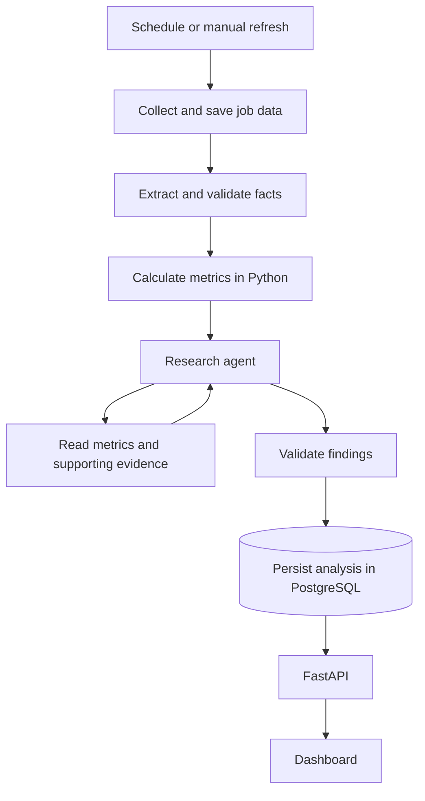

# Agentic automation roadmap

Status: proposed; all milestones below are planned. Recorded 2026-11-03. This document tracks future work; it does not describe an implemented agent or deployment.

The first product milestone is an automatically generated weekly research brief, backed by saved metrics and linked job evidence, served by the API without running a model during a request.

## Existing foundation

Reuse the current Python pipeline, PostgreSQL queue and provenance rather than replacing them with an agent framework:

| Capability | Existing implementation |
| --- | --- |
| Scheduling | Daily monitor schedules, timezone handling, daily deduplication and Sunday overlap |
| Execution | Durable collection runs, worker claims, leases and checkpoints |
| Extraction | Deterministic rules and optional schema-validated LLM extraction |
| Persistence | Job snapshots, evidence, extraction versions and metric snapshots |
| Recovery | Description retries, source cooldowns and durable model-call reservations |

See [architecture](architecture.md), [runbook](runbook.md), [pipeline](../src/market/pipeline.py) and [saved-description processing](../src/market/processing.py). Existing verification history is recorded in [review and status](review-and-status.md); this roadmap makes no new live verification claims.

## Proposed workflow

The agent chooses what to investigate. For example: AI engineering requirements appear to have increased; check whether this reflects more employers, repeated postings from one employer, or changed description coverage. It can choose read-only tools such as `compare_weeks`, `get_supporting_jobs` and `get_collection_quality`. Any new employer-concentration calculation belongs in Python, not in model-generated arithmetic.

Python retains responsibility for metric calculations, cohort eligibility, evidence validation and persistence. Existing complete-week and extraction-coverage gates continue to apply. An insufficient-data report is a valid outcome; the agent cannot turn missing observations into evidence of a trend.

## Deployment and libraries

Recommended first deployment: separate Render services sharing a managed PostgreSQL database, colocated with the backend.

| Component | Proposed deployment |
| --- | --- |
| Next.js frontend | Node web service |
| FastAPI | Python web service |
| Collection and analysis | Background worker using the same Python codebase |
| Database | Managed PostgreSQL |

Start with the existing `market worker --live` scheduler and queue, then extend execution to include separately tracked analysis tasks. Render background workers run continuously and suit queue-driven processing. The worker holds collection/model credentials server-side; the API serves saved results. No GPU deployment is needed when the model is accessed through a provider API. See [Render background workers](https://render.com/docs/background-workers).

Cloud Run Jobs triggered by Cloud Scheduler are an alternative when compute should start only for scheduled work. This needs an explicit strategy for draining queued work and delayed description retries: `market worker --once --live` currently processes only one queued run. Configure execution timeouts for the bounded collection and extraction workload. See [scheduled Cloud Run Jobs](https://docs.cloud.google.com/run/docs/execute/jobs-on-schedule).

| Layer | Choice and adoption point |
| --- | --- |
| Collection and extraction | Keep the vendored collector, current HTTP adapter and validation |
| Agent analysis | Use LangGraph when analysis chooses tools or branches between investigations |
| Validation and persistence | Reuse Pydantic, SQLAlchemy, Alembic and PostgreSQL |
| Scheduling and queue | Reuse the existing scheduler and database queue initially |

LangGraph supports explicit state, branching, persistence and pause/resume without adopting the full LangChain framework. A report that only summarises supplied metrics can start with an ordinary structured model call. Add the graph when investigation requires dynamic tool selection. See [LangGraph overview](https://docs.langchain.com/oss/python/langgraph/overview).

Use PostgreSQL-backed checkpoints for resumable graph execution. Keep checkpoints separate from validated analysis records consumed by the API. Checkpointing alone does not prevent duplicate paid requests after interruption; application-level claims and idempotency remain necessary. See [LangGraph persistence](https://docs.langchain.com/oss/python/langgraph/persistence).

Defer Prefect until many workflows, event-driven deployments or a broader workflow operations console justify it. It overlaps with the current scheduler and queue. See [Prefect deployments](https://www.prefect.io/docs/v3/concepts/deployments).

## Milestone tracker

Check an item only when its acceptance evidence is available. Record completion dates and links to implementation or verification alongside the milestone.

| Milestone | Status | Depends on | Deliverable |
| --- | --- | --- | --- |
| M1 — Unattended deployment | Planned | Existing pipeline | Scheduled collection and extraction with operational visibility |
| M2 — Durable analysis | Planned | Existing data model | Independently tracked, versioned analysis and safe publication |
| M3 — Bounded research agent | Planned | M2 | Tool-driven investigation with evidence and execution limits |
| M4 — API, dashboard and acceptance | Planned | M1–M3 | Weekly research brief served from saved results |

### M1 — Unattended deployment

- [ ] Add deployment configuration for the frontend, API, worker and managed PostgreSQL; install from existing lockfiles and include the vendored collector.
- [ ] Document migrations, deployed authentication, TLS/origin configuration, server-side secrets and backup/restore procedures for the selected host.
- [ ] Verify scheduled runs, manual refreshes, timezone behavior and delayed description recovery in the deployed environment.
- [ ] Monitor run failures, source pauses, queue age, data freshness and budget exhaustion. Current caught collection failures can leave the worker process exiting successfully; process health alone is insufficient.
- [ ] Complete a small live collection/extraction acceptance run and record its evidence before routine unattended operation.

Done when the deployment runs unattended, persists usable observations, and makes a failed or missed run visible to the operator.

### M2 — Durable analysis

- [ ] Track analysis independently of collection, with durable claims, lifecycle status and bounded recovery behavior. Analysis failure must preserve collected data.
- [ ] Extend/reuse the existing unused `Insight` model and add analysis-run persistence as needed, with Alembic migrations and corresponding readiness-check updates.
- [ ] Store monitor/query version, collection mode, reporting window, input fingerprint, extraction/metric/model/prompt versions, evidence references, usage and timestamps.
- [ ] Preserve the exact inputs or reproducible input manifest behind published findings. Metric snapshots can currently be updated, so a metric ID alone is insufficient provenance.
- [ ] Publish validated findings atomically; failed, interrupted or invalid attempts retain the previous valid report. Record when newer data awaits analysis.
- [ ] Extend durable paid-call reservations and idempotency to analysis. An uncertain provider request must not be silently repeated after a restart.
- [ ] Define an analysis budget separately from extraction. The default extraction cap of 100 calls/month covers only four batches of 25 new descriptions.

Done when duplicate execution, invalid output and interrupted requests cannot overwrite a valid report or silently repeat an uncertain paid call.

### M3 — Bounded research agent

- [ ] Implement one research agent with a small set of typed, read-only tools over saved metrics and evidence.
- [ ] Add LangGraph when the agent selects tools or investigation branches; persist graph checkpoints in PostgreSQL.
- [ ] Set explicit model-call, tool-call, input/output and wall-time limits, enforced by application code.
- [ ] Treat job descriptions as untrusted data. Tools enforce monitor, query-version, mode and reporting-window scope; expose no arbitrary SQL or unrestricted scraping.
- [ ] Validate structured findings, evidence references and numeric claims against saved inputs before publication. Preserve coverage caveats and complete-week eligibility rules.
- [ ] Check representative supported, unsupported and insufficient-data findings, plus budget exhaustion and resumed execution without duplicate paid calls.

Done when the agent can investigate a change, retrieve supporting evidence and either publish a validated finding or explain why the data cannot support one.

### M4 — API, dashboard and acceptance

- [ ] Add API reads for saved agent reports. The existing insights route currently computes deterministic findings per request; preserve its contract or document an explicit extension.
- [ ] Match reports to their monitor, query version, mode and reporting window. Do not serve a saved report as if it answers arbitrary date filters.
- [ ] Show evidence links, report generation time, data cutoff, latest-attempt status and whether newer data awaits analysis. Keep the last valid report available after a failed attempt.
- [ ] Schedule the weekly brief after a reporting week closes, with reruns keyed to changed eligible inputs rather than unconditional repeated model calls.
- [ ] Verify the full deployed flow from scheduled collection through validated analysis to API/UI, including an interrupted analysis and an insufficient-data week.
- [ ] Update API contracts, runbook and architecture to describe the implemented behavior and record acceptance evidence here.

Done when a scheduled weekly brief appears in the dashboard from persisted data, with no model call on the API request path and a visible stale/failure state when processing falls behind.

## Deferred scope and remaining risk

Multiple agents, Redis/Celery, vector search, unrestricted web research and a separate orchestration platform are deferred until a concrete requirement needs them. This plan adds no automatic source expansion or access-challenge bypass.

LinkedIn availability and rate limits remain the main collection risk. Hosting and agent tooling cannot guarantee complete observations. Existing collection gaps and sample/coverage limitations must remain visible in every published interpretation.
