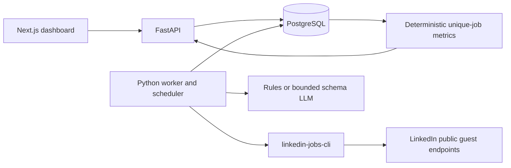

# Architecture

Next.js App Router and React provide a client dashboard. FastAPI handles validated requests and database reads. A separate Python worker uses linkedin-jobs-cli directly through its library interface. PostgreSQL is the deployment source of truth; SQLite supports offline single-process development. The API only enqueues work and returns 202. No Redis, remote scrape service or agent framework is required.

`src/market` contains config, contracts, relational models, API, pipeline, extraction and analytics. `vendor/linkedin-jobs-cli` is a source snapshot of the user's supplied package with collection-safety extensions, also applied to the sibling original. It is installed through a relative uv path dependency: no sibling checkout is needed. `db/migrations` contains frozen explicit operations and never imports current model metadata during a revision. API/worker startup does not run create_all.

Database constraints protect source identities, query versions, logical runs, sightings and extractor idempotency. PostgreSQL monitor row locks serialize manual/daily enqueue. A global advisory lock protects first budget-row creation; an atomic conditional update reserves global workload. Workers use FOR UPDATE SKIP LOCKED to claim queued rows. Independent request heartbeats update a two-minute collection lease. Extraction receives a two-hour lease for the maximum bounded workload. Expired work becomes interrupted and requires explicit replay; automatic retries never repeat uncertain paid extraction.

Collection diagnostics and raw checkpoints commit during download. Canonical ingestion is a single bounded transaction (at most 100 rows) and can roll back cleanly. If an application crashes before committing ingestion, replay the saved checkpoint; live partial downloads remain partial. Semantic snapshot hashes ignore volatile tracking and applicant counts while preserving title/company/location/pay/seniority/description changes. The first raw payload for a semantic snapshot remains intact, while each run checkpoint preserves that run's returned fields.

Metrics are computed from successful observations in one immutable query version and one collection mode. Demo data cannot appear in live aggregates. The current dashboard reads aggregates from stored observations; stored metric snapshots provide a reproducible materialization. Extraction model/prompt/taxonomy versions are exposed in metadata. A later model result is selected by extraction creation time; mixed versions are flagged.

Version-sensitive references used during implementation: [Next.js installation](https://nextjs.org/docs/app/getting-started/installation), the installed Next.js client/data-fetching guides, [SQLAlchemy locking](https://docs.sqlalchemy.org/en/20/core/selectable.html#sqlalchemy.sql.expression.Select.with_for_update), and [FastAPI testing](https://fastapi.tiangolo.com/tutorial/testing/). CLI behavior is grounded in its local source and tests.

Source health is durable and shared across monitors. The guest worker has no account-authentication adapter. Description tasks persist next-eligible attempt time, bounded attempts and last successful payload; response classification is based on public content and explicit access failures. Source pauses are exposed through a protected read endpoint. The queue claim is mode-specific and live execution separately requires authorization. Observations can advance to a newly enriched snapshot without duplicating job sightings. Cached/stale retrieval provenance is retained in the run checkpoint independently of semantic snapshot deduplication.

Focused extraction uses `market.selection` for deterministic section/excerpt selection, `market.extraction` for strict structured output and evidence validation, and `market.processing` for durable budgeted post-commit model execution. This path has no tools or scrape controls. Snapshot/model/prompt/selection version is the idempotency boundary. Collection always has a rules-based result before optional model processing; no database write transaction is held during a paid HTTP call. On-demand job source retrieval is separate from the concise structured detail response.
